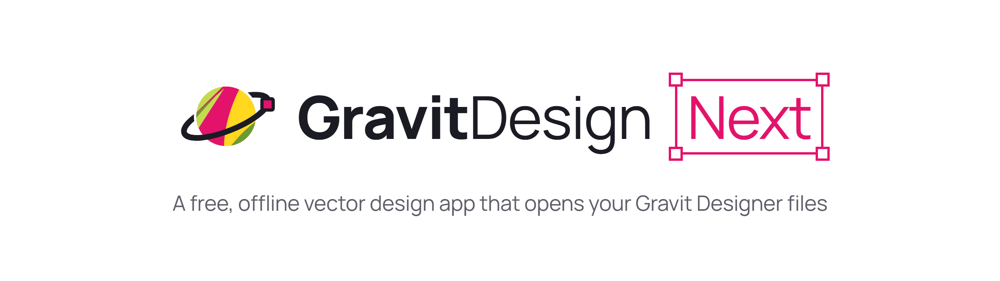
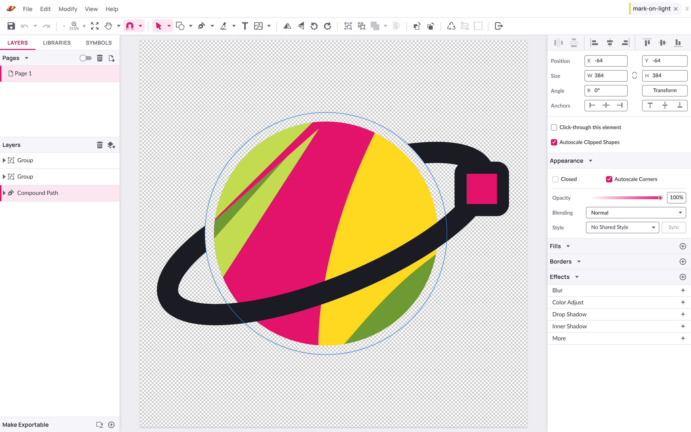
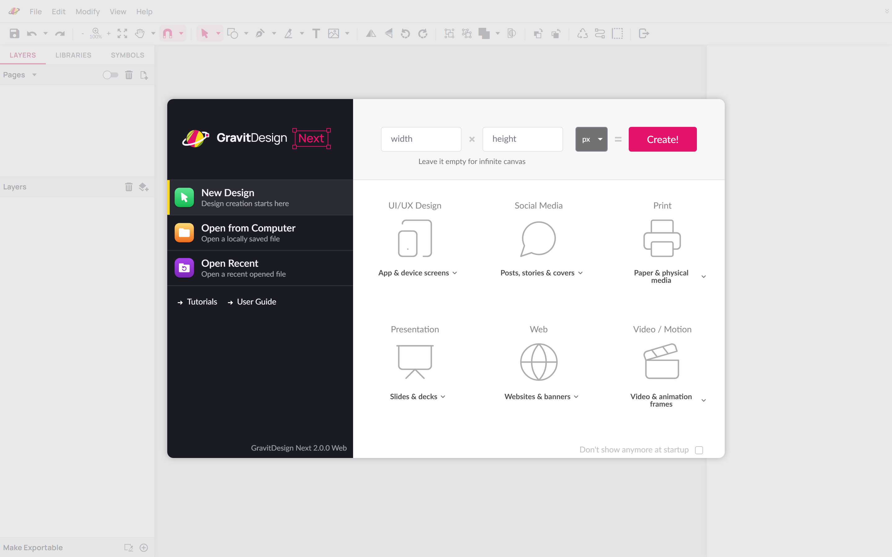
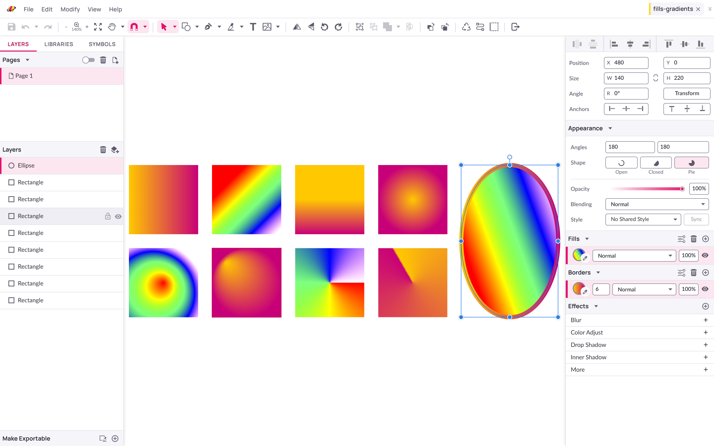
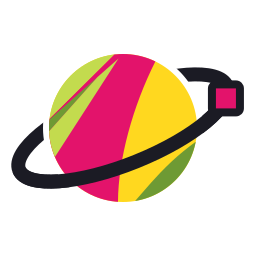

<p align="center">
  <picture>
    <source media="(prefers-color-scheme: dark)" srcset="docs/readme/banner-dark.png" />
    
  </picture>
</p>

<p align="center">
  <a href="https://github.com/GravitDesign/designer/releases"></a>
  
  
  <a href="https://github.com/GravitDesign/designer/issues"></a>
</p>

<p align="center">
  <picture>
    <source media="(prefers-color-scheme: dark)" srcset="docs/readme/hero-dark.png" />
    
  </picture>
</p>

GravitDesign Next is a community rebuild of Gravit Designer. It looks and
works much like the app you know, but it's a different app, made by
different people, rewritten in TypeScript and React.

It runs on your computer and works offline. There is no account, no cloud
and no subscription. A `.gvdesign` file opens in GravitDesign Next and in
the old Gravit Designer, so nothing you made gets stuck.

## What you get

- **The editor you know.** Pages, layers, symbols, shared styles, fills,
  borders, effects, text on paths and the rest of the Gravit toolset,
  checked against the old app by a parity suite.
- **Your files, on your disk.** Open and save `.gvdesign`, import SVG,
  PDF, EPS, Sketch and images (HEIC too), export PNG, JPG, SVG and PDF.
- **Everything unlocked.** The old Pro features are simply part of the
  app.
- **Desktop or browser.** An Electron app for Windows, Linux and macOS, or
  a small Node server you open in any browser.
- **Light and dark.** Both themes, in the new look or the old one.
- **Thumbnails in Explorer.** On Windows, `.gvdesign` files show a preview
  instead of a generic icon.

<table>
  <tr>
    <td width="50%">
      <picture>
        <source media="(prefers-color-scheme: dark)" srcset="docs/readme/start-dark.png" />
        
      </picture>
    </td>
    <td width="50%">
      <picture>
        <source media="(prefers-color-scheme: dark)" srcset="docs/readme/gradients-dark.png" />
        
      </picture>
    </td>
  </tr>
  <tr>
    <td align="center">Start from a preset or an infinite canvas</td>
    <td align="center">Gradients, fills and borders in the inspector</td>
  </tr>
</table>

## What's gone

Cloud sync, sharing and comments, and templates from the cloud. They
depended on Corel's servers. Something else broken or different from what
you're used to? Please [open an issue](https://github.com/GravitDesign/designer/issues).

## Download

Get the installer for your system from the
[releases page](https://github.com/GravitDesign/designer/releases).

## Run it from source

Needs Node.js 22.12 or newer.

```sh
npm ci
npm run build
npm start          # http://localhost:3100
npm run electron   # desktop app
```

`npm run dev` starts the Vite dev server instead. To see the old Gravit
Designer look, open the app with `?branding=classic` in the address;
`?branding=next` switches back.

## Tests

```sh
npm test           # unit tests
npm run lint
npm run typecheck
npx playwright test --project harness --project parity
```

The parity suite runs the old app next to the new one and compares them.
It expects the old app in `legacy/` (ignored by git), checked out from the
`parity-reference` tag, which is what the expected output was recorded
from. A few unit tests read it too.

On CI, a few render and export scenarios whose output depends on the
machine's renderer are skipped; they are listed in
`parity/support/ci-skip.ts` and still run locally.

```sh
git worktree add legacy parity-reference
cd legacy && npm install --no-save --no-package-lock express@5.1.0 send@1.2.0 serve-static@2.2.0 mime-types@3.0.1 mime-db@1.54.0 ws@8.18.2
```

## Layout

- `src/`, `server/`, `electron/`: the app
- `parity/`: the parity suite and its expected output
- `docs/rewrite/`: how the rewrite was planned and what changed
- `assets/`, `guide/`: images, fonts and the user guide, taken over from
  the old app
- `native/gvthumb/`: the Windows Explorer thumbnail provider
- `public/brand/`: the GravitDesign Next logo, colours and font

The old app is on the `legacy` branch.

## Brand

<picture>
  <source media="(prefers-color-scheme: dark)" srcset="public/brand/mark-on-dark.svg" />
  
</picture>

The mark is the old Gravit sphere as a planet, with a selected anchor on
its ring. The colours are yellow `#FFD81F`, magenta `#E3136B`, lime
`#C3DB4E`, olive `#6E9A34` and ink `#1B1B24`, and the type is
[Manrope](https://fonts.google.com/specimen/Manrope).

<br clear="left" />
